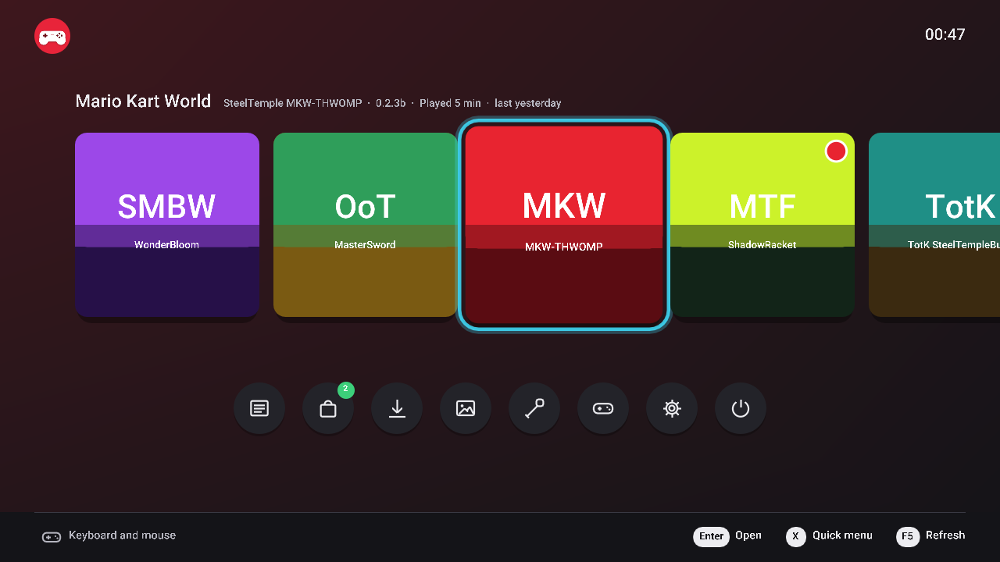
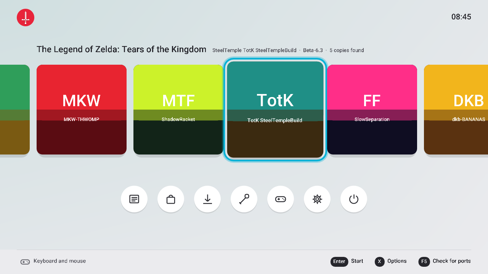
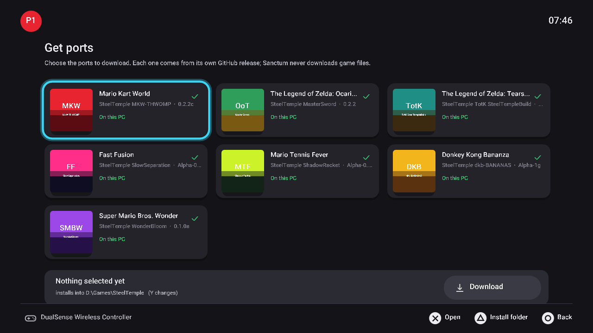
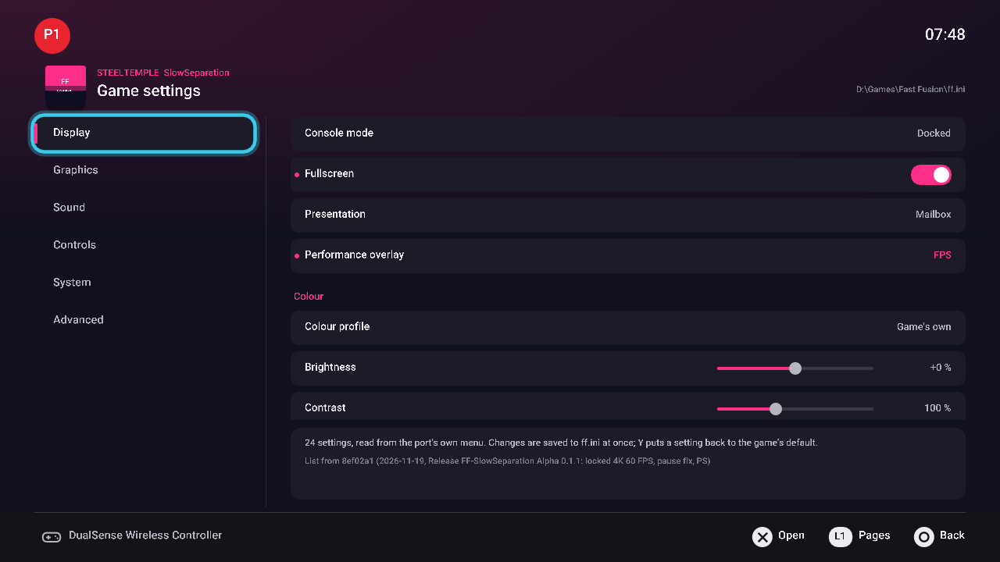
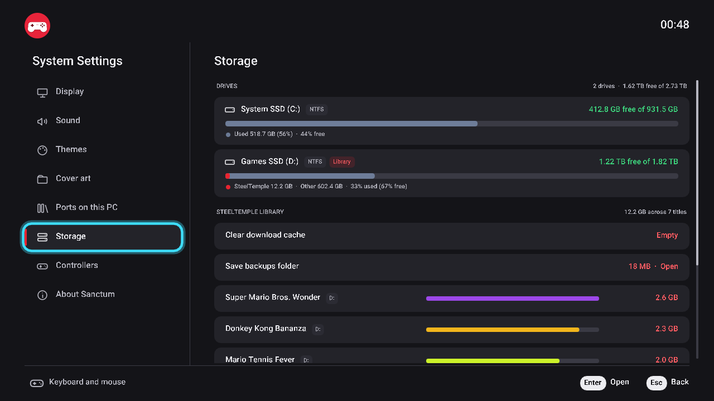
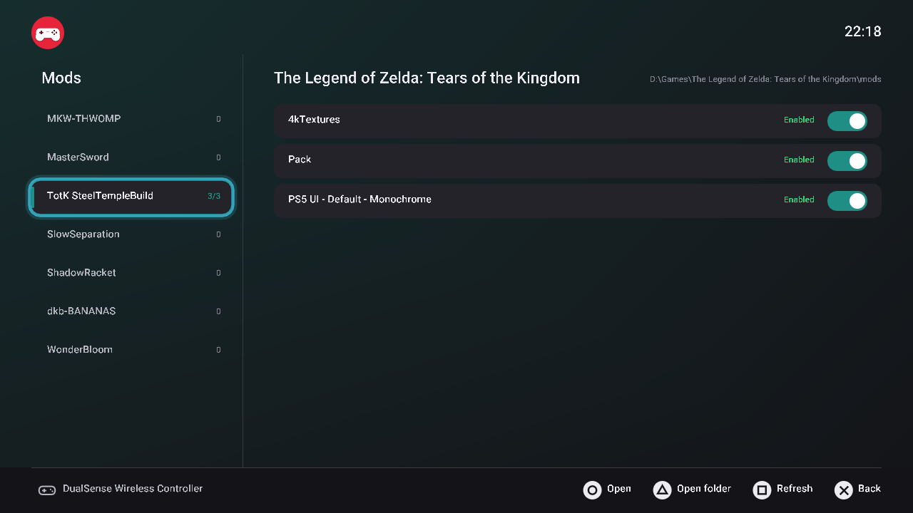
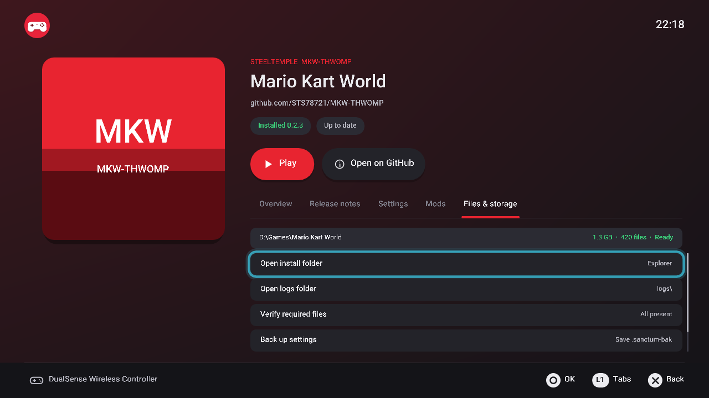
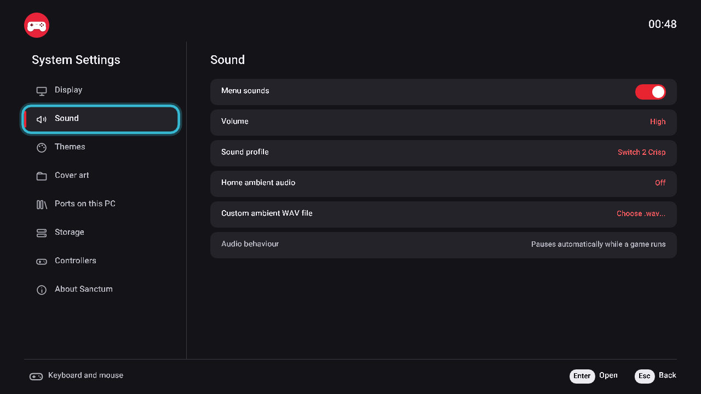
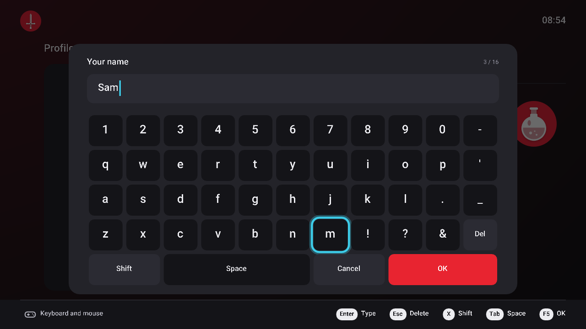
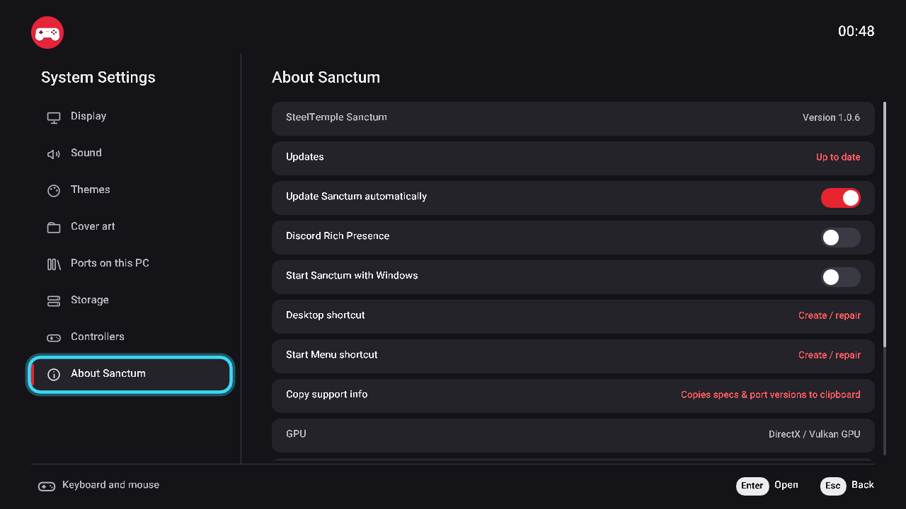

<div align="center">


# SteelTemple Sanctum

**One home for every SteelTemple PC port.**<br>
A console-style launcher for Windows that you can drive entirely with a controller: browse your ports, download them,
keep them up to date automatically, switch graphics presets, and start any game straight from the couch.

[](https://github.com/STS78721/SteelTempleSanctum/releases)


[**Download**](https://github.com/STS78721/SteelTempleSanctum/releases) ·
[Features](#features) · [Controls & shortcuts](#controls--power-shortcuts) · [Supported ports](#supported-ports) · [How it works](docs/TECHNICAL.md)



</div>

---

## Features

### 🏠 A home screen that feels like a console

Your installed games sit in one sleek horizontal row — sorted by **Last played**, **Most played**, or **A to Z**, with
the focused title hovering directly above its icon, **one-button direct Play / Quick Resume (`Y` / `△` / `Tab`)**,
**Quick menu (`X`)**, and an animated **Aurora Prism** selection border with elastic tile motion. At the end of the row,
**Show more** opens a full 6-column **All Games** library grid (with **All Games / Ports / Custom Games / Pinned** tabs,
floating title tooltips, left filter/sort/add rail, and an inline **+ Add custom** tile). Below the row, the centered
**Floating Pill** dock houses a featured **Get ports** button alongside **Downloads**, **Releases & news**, **Album**,
**Mods**, **Controllers**, **System Settings**, and **Power**. Sanctum opens fullscreen on your chosen monitor or TV
with optional **Start Sanctum with Windows (Console Mode)**, auto-hides the mouse pointer while using a controller, and
shows live **handheld/laptop and wireless controller battery indicators**, **12h/24h clock**, and **OLED Idle Dim**
protection.

<div align="center">

</div>

### 🎮 Transparent In-Game Quick Overlay, Instant Screenshots & Performance HUD

**Play** (or pressing **`Y` / `△` / `Tab`** straight from any tile) starts the game directly without opening the port's
own launcher. Sanctum steps aside while you play and returns cleanly when you quit.

- **True Transparent In-Game Quick Overlay (`Guide` / `Xbox` / `PS` / `Home`):** Renders as a lightweight transparent
  side panel directly over your live paused game frame (zero full-window switch flash). Adjust **Windows master volume**,
  swap **Audio output** (HDMI TV, headphones, speakers) straight from your controller, toggle the **Performance HUD**,
  take an instant screenshot, **Suspend game** (pauses CPU, GPU, audio, and play-time timer with a **Quick Resume**
  badge), **Resume** right back on the exact frame, or **Close / Force Quit** in one press. Automatically and reversibly
  suppresses Windows' Xbox Game Bar controller button while open.
- **Share / Create / Capture Button → Instant Screenshot to Album:** Press your DualSense **Create**, **Capture**, or
  Xbox **Share** button (or **`F12`** / **`PrtSc`** / Quick Overlay **Take screenshot**) to capture the live game window
  straight into Sanctum's **Album** with a crisp shutter click and click-through corner toast.
- **Zero-Inject Corner Performance HUD & Multi-Session FPS Sparkline:** Toggle an unobtrusive click-through corner pill
  (**Off** / **Compact FPS** / **Detailed: FPS · CPU · GPU · RAM · Battery**) right from the Quick Overlay or System
  Settings — zero DLL injection, works across every port and custom PC game — paired with a persistent multi-session
  **FPS trend sparkline** inside each game's **TIME PLAYED** card.
- **Per-Game Display Refresh Rate:** Optionally set a per-title display refresh rate (e.g. `60 Hz` or `120 Hz`, filtered
  to your monitor's supported modes) in **Files & storage**; Sanctum switches cleanly for gameplay and restores your
  desktop refresh rate automatically on exit or suspend.
- **One-Click Sanitized Crash Diagnostics Bundle & Freeze Recovery:** Export a sanitized `.zip` bundle (`system.txt`
  including GPU driver version, non-default `.ini` diff, and 64 KB log tail with personal usernames and local paths
  stripped) right from a port's crash card or **Files & storage** for clean GitHub bug reports. If a game ever freezes,
  press **Guide** → **Force quit game** or hold **Back + Start + L + R** for **2 seconds**.
- **Custom PC games & launch overrides:** Add any PC `.exe` right from **Show more** or System Settings, or configure
  per-game **custom launch arguments** and **environment variable overrides**.

<div align="center">

</div>

### 🔎 Fast detection & live port catalog

At start, Sanctum scans Setup Wizard entries and fixed drives for ports already on your PC so nothing is installed
twice. It reads each copy's exact version directly from its game binary (scanning only PE data sections so cold checks
finish in under a second), companion renderer DLLs, and `VERSION` files — ranking playable copies above bare launcher
folders.

- **Dynamic live catalog (`catalog.json`):** New SteelTemple ports and their settings layouts appear automatically in
  Sanctum when published, without waiting for a launcher update (cached locally for instant offline startup).
- **Multiple copies supported:** Keep dev builds and release copies side by side and choose which one **Play** starts.

### ⬇️ Zero-touch updates with automatic save backups & background relinking

**Get ports** lists every released port: tick the ones you want and press Download, or use **Update all** to queue every
available update in one press.

- **Automatic pre-update save snapshots:** Before overwriting an existing install during an update, Sanctum
  automatically zips your save folder into `%APPDATA%\SteelTemple\Sanctum\backups\<port>\` (keeping the last 5 rolling
  auto snapshots alongside your manual backups).
- **Zero-touch background auto-relink:** After applying an update package to a port that builds its executable on your
  PC, Sanctum automatically runs the port's bundled relink step in the background (`Relinking` progress chip in Downloads
  and the top status bar) so you can press **Play** immediately when it finishes — with automatic rollback if anything
  fails.
- **SHA-256 verification & version rollback:** Every download is verified against GitHub's published SHA-256 digest, and
  you can install or roll back to any earlier release straight from the **Release notes** tab (`X`).

<table>
<tr>
<td></td>
<td></td>
</tr>
<tr>
<td colspan="2"></td>
</tr>
</table>

### ⚙️ Each game's own settings + one-press Quick Graphics Presets

A port's **Settings** tab shows the exact pages, options, descriptions, and defaults from the game's own in-game menu,
in the port's colours — across **all 8 ports** (MKW-THWOMP, MasterSword, TotK SteelTempleBuild, SlowSeparation,
ShadowRacket, dkb-BANANAS, WonderBloom, and YATMB), plus any future port added to `catalog.json`.

- **One-press Quick Graphics Presets (`X`):** Switch between **Clean Default (1080p)**, **Balanced 1440p 60**,
  **Native 4K 60**, and **Handheld / Battery** from the preset bar or the `X` menu. Every preset validates its keys
  against that port's supported values and automatically backs up your `.ini` to `.sanctum-bak` before writing.
- **Non-destructive `.ini` editing:** Comments, layout, and unrelated keys stay untouched. Press **`Y`** on any row to
  reset it back to the game's default.

<table>
<tr>
<td></td>
<td></td>
</tr>
</table>

### ⚡ Performance Mode & Unified Smart Cache

**System Settings > Performance** (and the **Quick Overlay**) gives you console-style game boosting and instant library
loading — completely zero-admin and 100% reversible:

- **Performance Mode (`Auto while gaming` / `Always on` / `Off`):** Automatically boosts launched games to **Above
  Normal** CPU priority, disables Windows 11 **EcoQoS / E-core throttling** (`ProcessPowerThrottling`), tightens Windows'
  system timer resolution to **`1 ms`** for smoother frame pacing and higher 1% lows, prevents display/system sleep
  during controller sessions, switches Windows Power Plan / Power Overlay to **High Performance on AC power** (leaving
  battery power untouched on laptops and handhelds), and drops Sanctum itself into EcoQoS while trimming its working-set
  RAM while minimized. Every OS tweak restores cleanly on game Suspend, Exit, or Sanctum close.
- **Unified Smart Cache (`%LOCALAPPDATA%\SteelTemple\Sanctum\cache\`):** Persistently caches pre-decoded binary
  thumbnails (`.sthm`) for cover art and Album screenshots for near-instant cold loads, caches recursive folder sizes
  (`sizes.ini`) so large titles open in `0 ms`, and lets you inspect or clear Sanctum's caches in one click without
  touching saves, settings, or installed games.

### 💾 Storage, shader cache maintenance, save backups & mods

- **System Settings > Storage** shows every mounted drive's **total capacity, free space, used space, and SteelTemple
  library footprint**, plus one-click download cache cleanup and direct jumps into each title's storage page.
- **Shader & pipeline cache tools (`Files & storage`):** View the combined size of generated shader and Vulkan pipeline
  caches, clear stale caches safely to the Windows Recycle Bin in two presses (handy after GPU driver updates), or
  pre-warm seed shaders in the background on supported titles.
- **Cloud-Folder Save Sync Bridge (`System Settings > Storage`):** Point Sanctum at any synced folder (OneDrive, Google
  Drive, Syncthing, Dropbox, or a NAS share) to automatically mirror save snapshots after each play session, detect newer
  saves from another PC or handheld (e.g., ROG Ally, Legion Go) with a **Cloud save newer** status chip, and pull updates
  safely after backing up your existing local saves (`pre-sync-*.zip`).
- **Save backups & restore:** Create timestamped **ZIP save backups** (pure C++, zero external tools) and restore either
  manual backups or automatic pre-update snapshots with a 2-press safety guard and pre-restore snapshot.
- **Mod manager:** Open **Mods** from the Home dock or a port's **Mods** tab — or **drag and drop any `.zip` mod**
  straight onto Sanctum — to install and toggle mod folders safely without deleting files.

<table>
<tr>
<td colspan="2"></td>
</tr>
<tr>
<td></td>
<td></td>
</tr>
</table>

### 🕹️ Any controller, your button layout

Xbox, PlayStation, Switch Pro, Joy-Con and generic pads all work out of the box, and on-screen prompts match your pad.
**System Settings > Controllers** lets you choose **Button layout** (Automatic, Nintendo with A on the right, or Xbox
with A at the bottom), **Button icons**, **Controller vibration** and strength (**Low**, **Medium**, **High**), **Menu
stick deadzone**, the **Force-close chord**, and a live dual-stick, analog trigger, button & battery **Controller
Tester**. Keyboard and mouse work everywhere too.

<div align="center">

</div>

### 🎨 Themes Studio, Animations & Tactile Menu Sounds

**System Settings > Themes** brings appearance, focus-border animations, dock styling, and menu audio together into one
customizable studio (with live preview right on the active highlight):

- **Curated Theme Presets:** Switch in one press between **Sanctum Prism**, **Aqua Bubble**, **Port Accent**, and
  **Clean Minimal**, or customize any element individually.
- **Animated Selection Borders & Motion:** Choose **Aurora Prism**, **Spectrum Wave**, **Port Accent**, or **Classic
  Cyan** focus borders with configurable animation speed (**Static**, **Calm**, **Standard**, **Lively**), tile motion
  (**Off**, **Subtle**, **Elastic**), and Home dock style (**Floating Pill** or **Classic Circles**).
- **Tactile Menu Audio:** Crisp procedural UI sound profiles (**Tactile Click**, **Bubble Pop**, **Warm Retro**, **Soft
  Minimal**) with optional **Dynamic pitch & stereo pan** as you glide across icons, **Volume** control, and optional
  **Home ambient audio** (soft console hum or custom `.wav`), pausing automatically while a game runs.

<div align="center">

</div>

### 👤 Profiles, Album & your cover art

- **Profiles:** Create up to four local profiles, each with its own name, background colour, per-profile play time, and
  icon from 60 original designs in six sets (SteelTemple, Creatures, Food, Nature, Space and Play).
- **Album:** Browse screenshots from your ports and Windows Screenshots folder in a Switch-style grid with a full-screen
  lightbox and safe Recycle Bin delete.
- **Cover art:** Sanctum ships no game art. Point **System Settings > Cover art** at your own folder, pick a custom
  cover per title, or **drag and drop a `.png`/`.jpg` image** straight onto a game tile.

<table>
<tr>
<td></td>
<td></td>
</tr>
</table>

### 🛠️ System diagnostics & optional Discord Rich Presence

**System Settings > About** displays a hardware/OS diagnostics summary with one-click **Copy support info** for bug
reports, manages automatic background self-updates (with a one-time **"What's New"** card after each update), and
includes optional, off-by-default **Discord Rich Presence**.

<div align="center">

</div>

---

## Controls & power shortcuts

> [!TIP]
> **Sanctum Quick Overlay & Freeze Recovery from your controller:**
> - **Press the Guide / Xbox / PS / Switch Home button** (anytime in Sanctum or in-game) to slide open the **Sanctum
>   Quick Overlay** — adjust **System Volume**, **Suspend game (Quick Resume)** to pause CPU/GPU/audio while browsing
>   Sanctum, **Resume**, **Close**, or **Force Quit** the running game without leaving the couch. Sanctum automatically
>   suppresses Windows' Xbox Game Bar controller button while open and restores your Windows setting on exit (configurable
>   in **System Settings > Controllers**; if Steam is also running in the background, disable *"Guide Button Focuses
>   Steam"* in Steam > Settings > Controller).
> - **Force-close a frozen game:** Hold **Back + Start + L + R** for **2 seconds** to terminate a hung game immediately
>   and return straight to Sanctum:
>   - **Xbox / ROG Ally / Legion Go:** `View + Menu + LB + RB`
>   - **PlayStation (DualSense / DualShock):** `Create / Share + Options + L1 + R1`
>   - **Nintendo Switch Pro / Joy-Con:** `− + + + L + R`

| Action | Controller | Keyboard | Mouse |
|---|---|---|---|
| **Sanctum Quick Overlay (transparent over live games)** | **Press `Guide` / `Xbox` / `PS` / `Home`** | `Home` | Click outside to close |
| **Instant screenshot to Album** | **Press `Share` / `Create` / `Capture`** | `F12` / `PrtSc` | Quick Overlay → Take screenshot |
| **Direct Play / Quick Resume from tile (Home & Show more)** | **`Y` (or `Triangle`)** | `Tab` | Hover Play button on tile |
| **Force-close running / frozen game** | **Hold `Back + Start + L + R` (2 s)** | — | — |
| Move / navigate | D-pad / Left stick | Arrow keys / `WASD` | Hover / Scroll wheel |
| Open game / Confirm | `A` (or `Cross`) | `Enter` / `Space` | Left click |
| Back / Cancel | `B` (or `Circle`) | `Esc` / `Backspace` | Right click / Mouse Back |
| Quick menu (Home) / Pin (Show more) / Quick Presets (Settings) / Install version (Release notes) | `X` (or `Square`) | `X` | Click tile menu / preset pill |
| Open on GitHub (Game page) / Reset setting to default | `Y` (or `Triangle`) | `Y` / `Tab` | Click button |
| Switch tabs or settings pages | `L` / `R` (`LB` / `RB`) | `Q` / `E` (`PgUp` / `PgDn`) | Click a tab |
| Check GitHub for updates & new ports | `+` (`Menu` / `Options`) | `F5` / `=` | — |
| Secondary / sort action | `−` (`View` / `Share`) | `F1` / `-` | Click sort chip |
| Toggle Fullscreen | System Settings > Display (or Quick Overlay) | `F11` or `Alt+Enter` | — |
| Install mod / set custom cover art | — | — | Drag & drop `.zip` or `.png`/`.jpg` onto window |

---

## Supported ports

| Game | Port | Repository |
|---|---|---|
| Mario Kart World | **MKW-THWOMP** | [STS78721/MKW-THWOMP](https://github.com/STS78721/MKW-THWOMP) |
| The Legend of Zelda: Ocarina of Time | **MasterSword** | [STS78721/OOT-MASTERSWORD](https://github.com/STS78721/OOT-MASTERSWORD) |
| The Legend of Zelda: Tears of the Kingdom | **TotK SteelTempleBuild** | [STS78721/totk-pc-recomp-SteelTempleBuild](https://github.com/STS78721/totk-pc-recomp-SteelTempleBuild) |
| Fast Fusion | **SlowSeparation** | [STS78721/SlowSeparation](https://github.com/STS78721/SlowSeparation) |
| Mario Tennis Fever | **ShadowRacket** | [STS78721/MTF-ShadowRacket](https://github.com/STS78721/MTF-ShadowRacket) |
| Donkey Kong Bananza | **dkb-BANANAS** | [STS78721/dkb-BANANAS](https://github.com/STS78721/dkb-BANANAS) |
| Super Mario Bros. Wonder | **WonderBloom** | [STS78721/SMBWONDERBLOOM](https://github.com/STS78721/SMBWONDERBLOOM) |
| Yoshi and the Mysterious Book | **YATMB** | [STS78721/YATMB](https://github.com/STS78721/YATMB) |

New SteelTemple ports and releases show up automatically via [`catalog.json`](catalog.json). Press **`+`** (`Menu` /
`Options` / `F5`) to check right away.

## Getting started

1. Download the latest Sanctum from [**Releases**](https://github.com/STS78721/SteelTempleSanctum/releases) and
   unzip it anywhere.
2. Start `SteelTemple-Sanctum.exe`. Ports you already have appear on Home within a few seconds.
   From then on Sanctum updates itself: a new version downloads in the background and goes in when you close it.
3. Open **Get ports** to download more. A port that builds its game from your files asks for them on its first
   start, through **Set up** on its page — and future updates automatically back up your saves and relink in the
   background.
4. Optional: in **System Settings > About**, add a Desktop or Start Menu shortcut, or turn on **Start with Windows**.

> [!IMPORTANT]
> Sanctum and the ports never include or download game files. Every port runs from **your own** legally dumped copy
> of the game.

## Your privacy

- No account, sign-in or token. Sanctum only reads the public catalog and release lists from GitHub, and caches them
  with ETags so it rarely needs to ask.
- Nothing about you or your PC is sent anywhere.
- Your settings, play time, save backups and cover-art choice stay in your own Windows profile (`%APPDATA%\SteelTemple\Sanctum\`).
  Nothing is written into the ports' downloads or releases.

## Building from source

Sanctum is C++20 with SDL3 and Dear ImGui. It builds to a single exe of about 6 MB with no DLLs to install.

```sh
python tools/build.py --llvm-mingw <llvm-mingw folder> --sdl <SDL3 static prefix>
```

[docs/TECHNICAL.md](docs/TECHNICAL.md) covers how ports are found, downloaded, started and configured, where Sanctum
keeps its files, the test hooks, and a map of the source.

## Credits

Built by **SteelTemple**. It uses [SDL3](https://libsdl.org) (zlib),
[Dear ImGui](https://github.com/ocornut/imgui) (MIT), [stb_image](https://github.com/nothings/stb) (public domain /
MIT) and [Roboto](https://fonts.google.com/specimen/Roboto) (Apache 2.0).

<sub>SteelTemple Sanctum is an unofficial fan project. It is not affiliated with or endorsed by Nintendo. All game
titles are trademarks of their respective owners.</sub>
