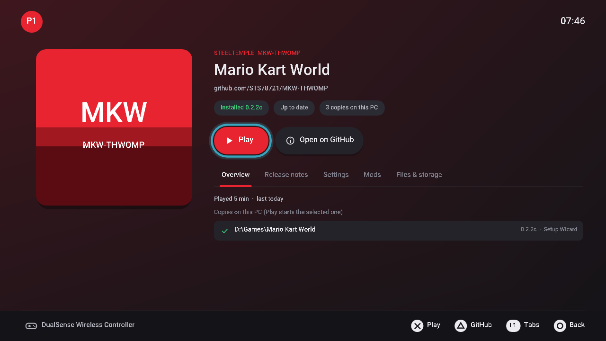
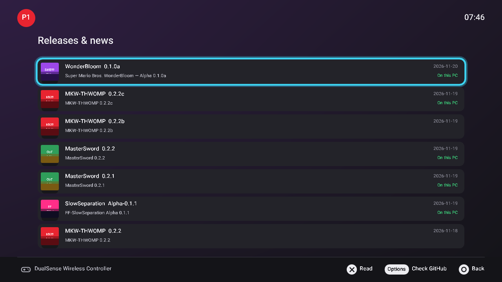
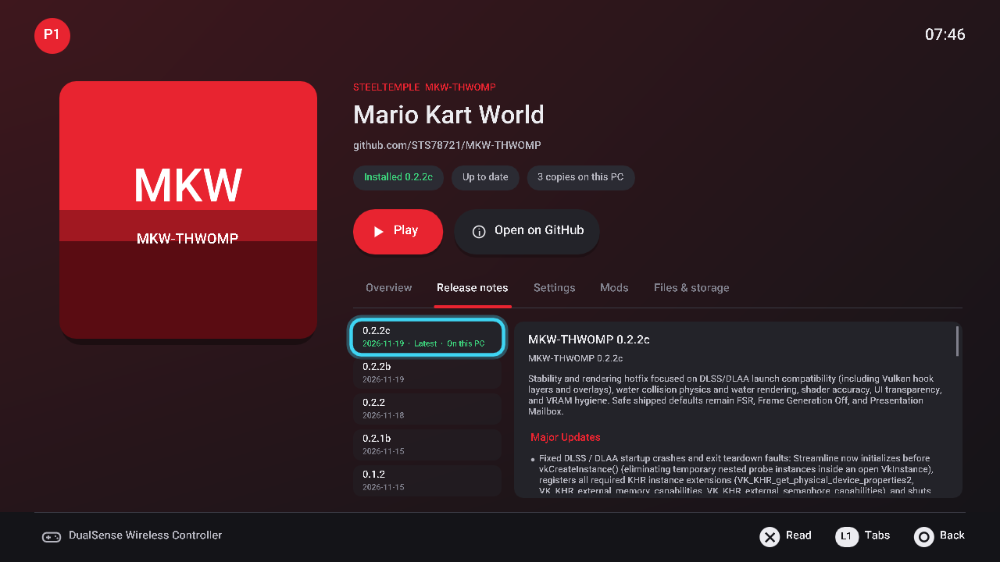
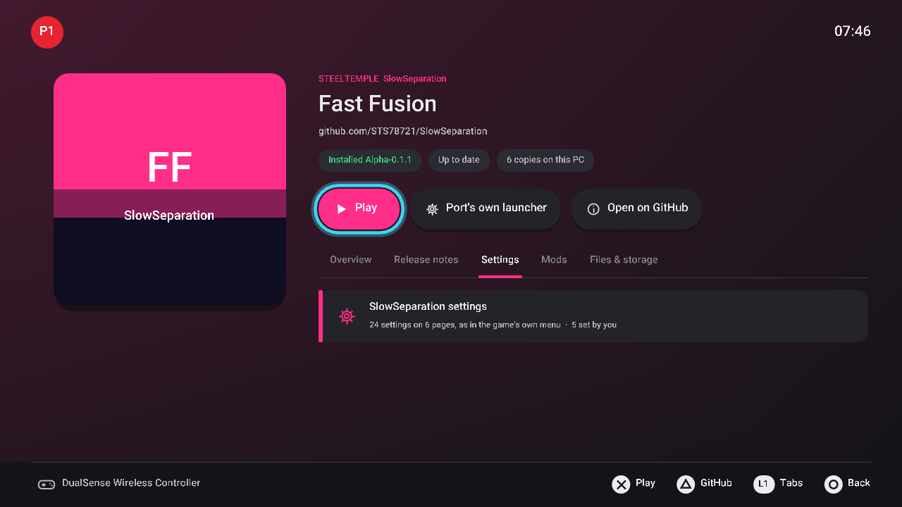
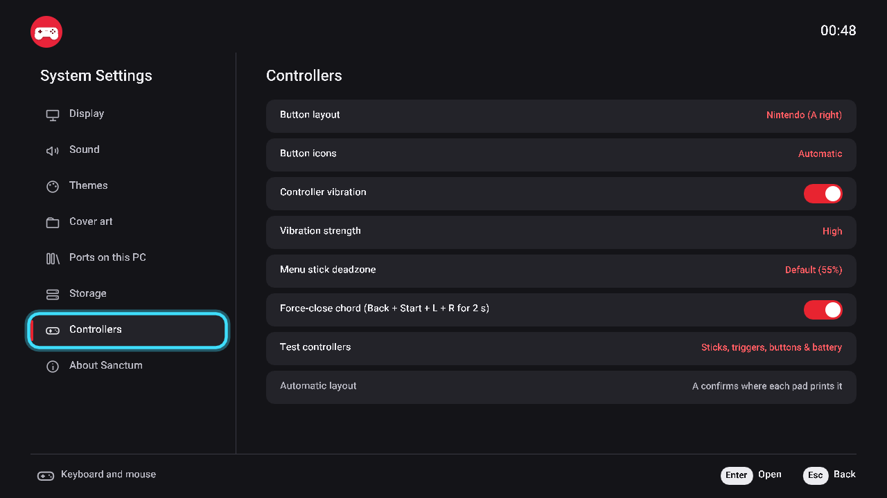
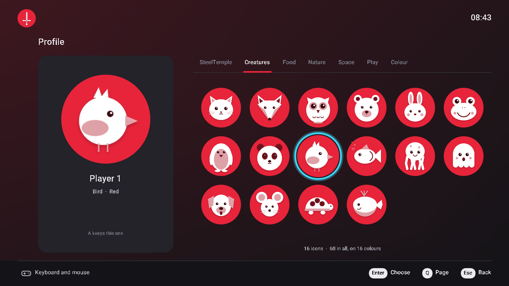

<div align="center">


# SteelTemple Sanctum

**One home for every SteelTemple PC port.**<br>
A console-style launcher for Windows that you can drive entirely with a controller: browse your ports, download them,
keep them up to date, change their settings, and start any game straight from the couch.

[](https://github.com/STS78721/SteelTempleSanctum/releases)


[**Download**](https://github.com/STS78721/SteelTempleSanctum/releases) ·
[Features](#features) · [Supported ports](#supported-ports) · [Controls](#controls) · [How it works](docs/TECHNICAL.md)


</div>

---

## Features

### 🏠 A home screen that feels like a console

Your ports sit in one row, ordered by what you played last, each in its own colours. The round buttons below
open News, Get ports, Downloads, Controllers, System Settings and Power. Sanctum opens fullscreen and hides the
mouse pointer while you use a controller. Dark and Light themes are included, and Home can take on the colours of
the port you select.

<div align="center">

</div>

### 🎮 Press Play and you're in the game

**Play** starts the game itself and skips the port's own launcher. Sanctum steps aside while you play and comes back
when you quit, on the game's page with a note on how the run went. If something went wrong, the log and the issue
report are one button away. Sanctum also counts how long you've played each port.

<div align="center">

</div>

### 🔎 Finds the ports you already have

At start, Sanctum looks through the Setup Wizards' entries and every drive for ports already on this PC, so nothing
is installed twice. It reads each copy's real version from its game program. If you have more than one copy, you
pick which one Play starts.

### ⬇️ Get ports, update them, read what's new

**Get ports** lists every released port: tick the ones you want and press Download. Downloads run in the background
while you keep browsing. Each one is checked against the SHA-256 that GitHub publishes, and an update keeps a way
back if it fails. Every port's release notes can be read on its own page, and **Releases & news** puts all of them in
one list.

<table>
<tr>
<td></td>
<td></td>
</tr>
<tr>
<td colspan="2"></td>
</tr>
</table>

### ⚙️ Each game's own settings, from the couch

A port's **Settings** tab shows the same pages, options and values as the game's own in-game menu, in the port's
colours. Changes go straight into the game's settings file, and its comments and layout stay as they are. **Y** puts
any option back to the game's default.

<table>
<tr>
<td></td>
<td></td>
</tr>
</table>

### 🕹️ Any controller, your button layout

Xbox, PlayStation, Switch Pro, Joy-Con and generic pads all work, and the on-screen hints show your pad's own
buttons. Like the ports' F1 menus, **System Settings > Controllers** lets you choose the **Button layout**
(Automatic, Nintendo with A on the right, or Xbox with A at the bottom) and the **Button icons**. Keyboard and mouse
work everywhere too.

<div align="center">

</div>

### 👤 Your profile icon

Pick your icon from 60 original designs in six sets (SteelTemple, Creatures, Food, Nature, Space and Play), then
choose one of 16 background colours. The large icon on the left previews whatever you highlight, and **A** keeps it.
Your icon then shows on Home and on every screen.

<div align="center">

</div>

### 🖼️ Your cover art, on your tiles

Sanctum ships no game art. Point **System Settings > Cover art** at your own folder of images, and each one is
matched to its port by name (for example `Mario Kart World.png`). The tiles update by themselves when you add or
change a picture. A port without a cover shows its colours and short name, as in the screenshots here.

---

## Supported ports

| Game | Port | Repository |
|---|---|---|
| Mario Kart World | **MKW-THWOMP** | [STS78721/MKW-THWOMP](https://github.com/STS78721/MKW-THWOMP) |
| The Legend of Zelda: Ocarina of Time | **MasterSword** | [STS78721/OOT-MASTERSWORD](https://github.com/STS78721/OOT-MASTERSWORD) |
| The Legend of Zelda: Tears of the Kingdom | **TotK SteelTempleBuild** | [STS78721/totk-pc-recomp-SteelTempleBuild](https://github.com/STS78721/totk-pc-recomp-SteelTempleBuild) |
| Fast Fusion | **SlowSeparation** | [STS78721/SlowSeparation](https://github.com/STS78721/SlowSeparation) |
| Mario Tennis Fever | **ShadowRacket** | [STS78721/MTF-ShadowRacket](https://github.com/STS78721/MTF-ShadowRacket) |
| Donkey Kong Bananza | **dkb-BANANAS** | [STS78721/dkb-BANANAS](https://github.com/STS78721/dkb-BANANAS) |
| Super Mario Bros. Wonder | **WonderBloom** | [STS78721/SMBWONDERBLOOM](https://github.com/STS78721/SMBWONDERBLOOM) |

New releases of these ports show up in Sanctum by themselves. Press **+** (Menu / Options) to check right away.

## Getting started

1. Download the latest Sanctum from [**Releases**](https://github.com/STS78721/SteelTempleSanctum/releases) and
   unzip it anywhere.
2. Start `SteelTemple-Sanctum.exe`. Ports you already have appear on Home within a few seconds.
3. Open **Get ports** to download more. A port that builds its game from your files asks for them on its first
   start, through **Set up** on its page.

> [!IMPORTANT]
> Sanctum and the ports never include or download game files. Every port runs from **your own** legally dumped copy
> of the game.

## Controls

| | Controller | Keyboard | Mouse |
|---|---|---|---|
| Move | D-pad / left stick | Arrows / WASD | Hover |
| Confirm | A | Enter / Space | Left click |
| Back | B | Esc / Backspace | Right click |
| Options / GitHub | X / Y | X / Tab | |
| Switch tabs or pages | L / R | Q / E | Click a tab |
| Check for ports | + (Menu / Options) | F5 | |
| Back to Home | Home (Guide) | Home | |
| Fullscreen | System Settings > Display | F11 or Alt+Enter | |

## Your privacy

- No account, sign-in or token. Sanctum only reads the public release lists from GitHub, and caches them so it
  rarely needs to ask.
- Nothing about you or your PC is sent anywhere.
- Your settings, play time and cover-art choice stay in your own Windows profile. Nothing is written into the ports'
  downloads or releases.

## Building from source

Sanctum is C++20 with SDL3 and Dear ImGui. It builds to a single exe of about 6 MB with no DLLs to install.

```sh
python tools/build.py --llvm-mingw <llvm-mingw folder> --sdl <SDL3 static prefix>
```

[docs/TECHNICAL.md](docs/TECHNICAL.md) covers how ports are found, downloaded, started and configured, where Sanctum
keeps its files, the test hooks, and a map of the source.

## Credits

Built by **SteelTemple**. It uses [SDL3](https://libsdl.org) (zlib),
[Dear ImGui](https://github.com/ocornut/imgui) (MIT), [stb_image](https://github.com/nothings/stb) (public domain /
MIT) and [Roboto](https://fonts.google.com/specimen/Roboto) (Apache 2.0).

<sub>SteelTemple Sanctum is an unofficial fan project. It is not affiliated with or endorsed by Nintendo. All game
titles are trademarks of their respective owners.</sub>
